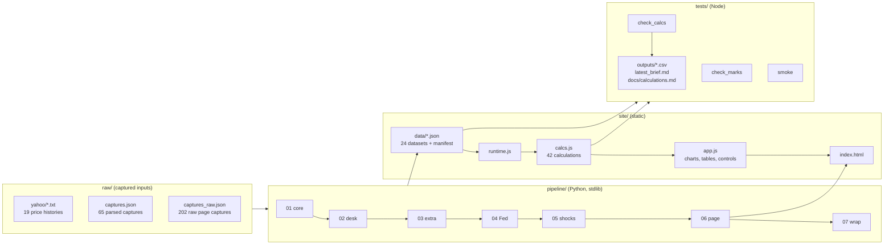

# 01 · Build steps

This guide covers how the monitor is put together and how to rebuild, test, deploy and extend it. The first part describes how the project was developed, step by step. The second part is the build you run.

- [Design goals](#design-goals)
- [How the project was built](#how-the-project-was-built)
- [Architecture](#architecture)
- [The pipeline, step by step](#the-pipeline-step-by-step)
- [The page](#the-page)
- [Tests](#tests)
- [Running it](#running-it)
- [Deploying to GitHub Pages](#deploying-to-github-pages)
- [Extending the monitor](#extending-the-monitor)

## Design goals

1. **Every number traces to data.** The page holds no hard-coded figures. Each of its 444 numbers is bound to a dataset or calculation and computed when the page loads. A test fails if any of them cannot resolve.
2. **Research and judgment stay separable.** Market data, researched facts and analyst judgments sit in different fields with different labels, so a reviewer can change an assumption (a scenario probability, a risk score) and watch it flow through.
3. **Answer the PM's questions in the PM's order.** The page leads with the regime, the ranked ideas and the scenario stress, and puts the evidence and method behind them.
4. **Reproducible from raw captures.** Running `run.sh` rebuilds every dataset and the page from `raw/`, byte for byte.
5. **No infrastructure.** The pipeline uses only Python's standard library and the site is static files, so it runs on a laptop and deploys to GitHub Pages.

## How the project was built

The monitor was built in six stages. Each stage added a layer of questions it could answer.

| Stage | What was added | Why |
|---|---|---|
| **1. Core monitor** | Daily prices for Brent, the 10-year, MOVE, VIX, S&P 500, gold, the dollar and HY spreads. A catalyst tracker with sources and risk scores. A Washington monitor (Congress, Supreme Court, agencies), US and EU regulation, a catalyst calendar, the daily geopolitical risk index, prediction markets and alternative indicators (Hormuz transits, dated Brent premium) | Establish what is happening and how stressed markets are |
| **2. Regions and trading signals** | Asia-Pacific, Africa and Latin America catalysts and gauges (TAIEX, USD/KRW, USD/INR, copper, cocoa, USD/ZAR, Bovespa, USD/BRL, USD/MXN, USD/COP). A 17-asset framework with transmission channels and hedge and fade expressions. The exposure index, pricing gap, signal board, event study, hedge ranking and Hormuz scenario weights | Turn "risk is rising" into "this asset is under-priced, and here is the trade" |
| **3. Reorganised for PMs and directors** | The Brief view (regime, ranked trade ideas, movers, next 30 days, desk views, headway). Seven desk views with 22 more series and 11 derived spreads. 2019–25 historical analogs for confirmation, the options-vs-outright vehicle check, the gap backtest, a deliverables roadmap and the Method view | Communicate measures, evidence and progress the way a morning meeting consumes them |
| **4. Fed tracker** | The rates corridor (EFFR, SOFR, IORB, ON RRP, Treasury 3M/2Y/10Y). The H.4.1 balance sheet (reserves, TGA, holdings, standing repo, discount window). A plumbing monitor with thresholds, a communications tracker with stance scores, decisions and dissents, hike pricing, the 28 Oct FOMC scenario tree and rate-shock betas | Track the Fed's small moves and what each one signals for markets and traders |
| **5. Cross-asset shock lab** | Six defined shocks, three-factor betas (2-year, Brent, equity), the shock × asset impact matrix, a simulator, transmission by desk, ranked hedges and exposures, and the Hormuz × FOMC combined scenarios on a 60/40 | Show what each shock does to every asset, and how to hedge it |
| **6. Repository** | The standalone runtime, the numbered pipeline, tests, exported outputs, generated reference docs and these guides | Make it reproducible, reviewable and shareable |

Stages 1 to 5 were first built and published as an interactive dashboard. Stage 6 moved the same data and page into this repository and added a small runtime so it runs anywhere. The datasets the pipeline rebuilds are byte-identical to the published version.

## Architecture



Data flows one way: raw captures go into datasets, datasets into calculations, and calculations onto the page and into the exported outputs. Nothing on the page writes back.

## The pipeline, step by step

Each step is a plain Python script. Shared paths live in `pipeline/paths.py`. The steps run in order because later steps extend datasets written by earlier ones.

| Step | Script | Reads | Writes to `site/data/` | What it does |
|---|---|---|---|---|
| 1 | `01_build_core.py` | `raw/yahoo/*.txt`, `raw/yahoo/hy.csv`, `raw/captures*.json` | `markets`, `fred`, `gpr`, `indicators`, `predictions`, `catalysts`, `washington`, `regulation`, `calendar`, `scenarios`, `framework` | Parses the 19 core price histories (weekdays only, from 9 Oct 2025; where captures overlap, the most recent fetch wins) and the FRED HY spread. Writes the researched datasets with a source link on every row and the 17-asset framework |
| 2 | `02_build_desk.py` | `raw/captures.json` | `desk`, `hist` | Adds 22 desk series from 3 Nov 2025 (sector ETFs, vol indices, Treasury tenors, crude and products, tanker equity, wheat, FX, ICE BofA spreads). Also writes 2019–25 price windows for the six core series around eight historical shocks |
| 3 | `03_build_extra.py` | step 1–2 outputs, captures | `hist_events`, `desks`, `roadmap`; extends `framework`, `fred` | Defines the historical analog events, the seven desks (question, what to watch, gaps), the deliverables roadmap, and the breakeven and real-yield snapshot |
| 4 | `04_build_fed.py` | NY Fed, Treasury and FRED captures | `fed_daily`, `fed_weekly`, `fed_decisions`, `fed_comms`, `fed_pricing`, `fed_playbook`, `fed_scenarios` | Builds the daily corridor (EFFR, SOFR and their 99th percentiles, target range, IORB, ON RRP, Treasury 3M/2Y/10Y) and the weekly H.4.1 series. Adds the researched decisions, communications and hike pricing, the plumbing playbook (thresholds, signals, actions) and the four FOMC scenarios |
| 5 | `05_build_shocks.py` | `roadmap` | `shocks`; extends `roadmap` | Defines the six shocks for the shock lab: three event shocks measured from history and three factor shocks driven by betas |
| 6 | `06_build_page.py` | `templates/v2_sections.html` | `site/dashboard.html` | Generates the page body: nine views, every number written as a data-bound placeholder (see below) |
| 7 | `07_wrap_site.py` | all datasets, `templates/dataset_meta.json` | `manifest.json`, `site/index.html`, `docs/data_inventory.md`, `docs/sources.md` | Writes the manifest (title, description, rows, date coverage, size per dataset), wraps the page into a standalone HTML document, and generates the data inventory and the source list |

### Why the raw captures are stored

Prices and research were fetched from public pages (see [data inputs](02_data_inputs.md)). The fetched content is stored in `raw/` exactly as captured: Yahoo history text, FRED and NY Fed observations, the Treasury yield CSV and the text of research pages. This means:

- the build is deterministic and works offline;
- anyone can audit a number back to the page it came from;
- a live data feed can later replace a capture file without touching the steps after it.

## The page

The page is three files plus the data:

| File | Role |
|---|---|
| `site/index.html` | The document: theme, d3 7.9.0 (from cdnjs), the runtime and the page body from step 6 |
| `site/runtime.js` | Loads `data/manifest.json` and every dataset, runs each `dash.calc` in dependency order, then notifies the page. API: `dash.calc(id, {inputs, title, description, fn})`, `dash.data(id)` → `{status, data}`, `dash.onData(cb)`, `dash.setLink(hash)` |
| `site/calcs.js` | The 42 calculations. Each declares its inputs, a title and a plain-English description; the descriptions become [the calculation reference](calculations.md) |
| `site/app.js` | Fills placeholders, draws the charts (d3), builds the sortable tables and wires up the tabs, desk switcher, shock simulator sliders and presets |
| `site/theme.css` | Colour and type tokens, with light and dark values |

### Data-bound placeholders

Every number on the page is a placeholder that names its source, so no figure is typed into the HTML:

```html
<b data-source="stress_latest" data-field="composite" data-fmt="int">—</b>
<span data-source="trade_ideas" data-field="gap" data-where="rank=1" data-fmt="sint">—</span>
```

- `data-source` is a dataset or calculation id.
- `data-field` is the column.
- `data-where` picks the row (`series=Gold`, `rank=1`; `&` for several conditions).
- `data-fmt` is a formatter: `int`, `sint` (signed), `ord` (ordinal), `pctint`, `sbp1` (signed bp) and so on.

When the data changes, every sentence on the page updates with it, including prose such as *"Gold has not hedged this year (−3.2%, up in 17% of escalations)"*. In `06_build_page.py` the helper `m(source, field, where, fmt)` writes these placeholders.

## Tests

`run.sh` runs three test scripts after the pipeline. They load the datasets and run `calcs.js` the same way the browser does (`tests/lib.mjs`).

| Test | Checks | Also writes |
|---|---|---|
| `tests/check_calcs.mjs` | All 42 calculations resolve, in dependency order. 17 invariants hold, among them: one signal per asset class; Hormuz and FOMC probabilities each sum to 1 and the combined grid is complete; every signal and regime label obeys its stated threshold; factor self-betas equal 1; percentile ranks lie in 0–100; no series is both a hedge and an exposure | `outputs/*.csv` (14 tables), `outputs/latest_brief.md`, `docs/calculations.md` |
| `tests/check_marks.mjs` | Every one of the page's 444 placeholders points to an existing dataset or calculation, field and row | — |
| `tests/smoke.mjs` | Loads `index.html` with the real runtime in jsdom. Clicks all nine tabs, all seven desks, every shock preset, slider and Simulate button. Fails on any script error, empty placeholder or element stuck loading | — |

Last run: 42 calculations, all invariants passing; 444 placeholders, 0 problems; 9 tabs, 0 script errors, 0 empty placeholders. The page was also rendered in headless Chromium at desktop (1360 px) and phone (390 px) widths, with no console errors and no horizontal overflow. The screenshots in `docs/img/` come from that run.

## Running it

```bash
bash run.sh                          # all seven steps, then tests and exports
python3 -m http.server -d site 8000  # view at http://localhost:8000

# or piece by piece
python3 pipeline/04_build_fed.py     # rebuild one step (re-run later steps after it)
npm test                             # tests and exports only
```

`run.sh` stops at the first failing step (`set -euo pipefail`). If Node.js is missing, it still rebuilds the data and page and prints a note that the tests were skipped.

## Deploying to GitHub Pages

The repository includes `.github/workflows/pages.yml`. On every push to `main`, it first runs the page tests (`check_marks` and `smoke`). If they pass, it uploads `site/` as the Pages artifact and deploys it. To turn it on, go to **Settings → Pages → Build and deployment → Source** and choose **GitHub Actions**. The site will then be at `https://<user>.github.io/geopolitical-risk-monitor/`.

The workflow deploys the committed `site/` folder; it does not rebuild. Run `run.sh` locally and commit the results when the data changes.

## Extending the monitor

**Add a market series.** Save the price history to `raw/` (or add its capture to `raw/captures.json`), then add a tuple to the series list. Core series go in `01_build_core.py` as `(name, file, ticker, unit, source)`. Desk series go in `02_build_desk.py` as `(name, url key, ticker, unit, desk, kind, source)`. `kind` is `price` (moves in log %), `rate` (moves in bp) or `level` (absolute moves). The series then flows into the universe, the latest readings, the event study, the shock betas and the shock matrix automatically.

**Add a catalyst.** Add a row to the catalyst list in `01_build_core.py` with region, theme, channel, status, an analyst risk score of 1–5, the affected assets and a source link. A dated past Middle East event with `direction` +1 (escalation) or −1 (de-escalation) also enters the event study and the escalation shock bundles.

**Add a shock.** Add a row to `shocks` in `05_build_shocks.py`. An event shock points to an event-study field (`esc_mean`, `deesc_mean`, `hist_esc_mean`) and a horizon in days. A factor shock sets `y2` (bp), `oil` (%) and `spx` (%) and uses the three-factor betas. It appears in the matrix, simulator presets, transmission and hedge tables.

**Change a judgment.** Scenario probabilities are in `scenarios` (Hormuz) and `fed_scenarios` (FOMC). Risk scores are `analyst_risk` in `catalysts`, and exposure ratings sit in the framework. Plumbing thresholds are `warn` and `alert` in `fed_playbook`. Edit the step that writes them, re-run `run.sh`, and every dependent number, ranking and sentence updates.

**Add a calculation.** Register it in `site/calcs.js` with `dash.calc(id, {inputs, title, description, fn})`. Bind it on the page with `m(id, field, …)` in `06_build_page.py`, and add an invariant to `tests/check_calcs.mjs`.
