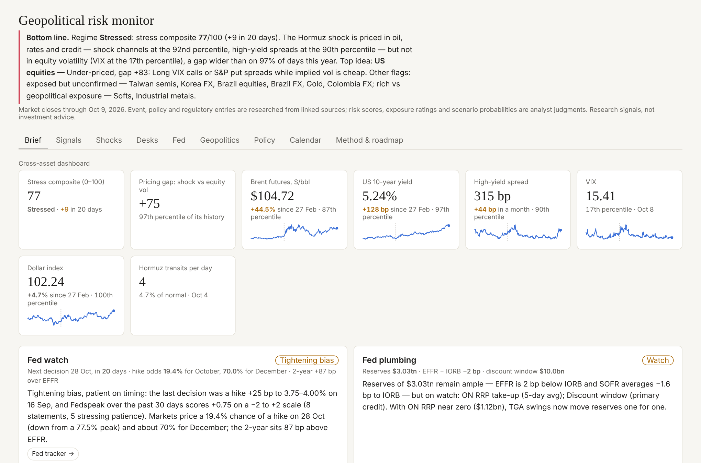
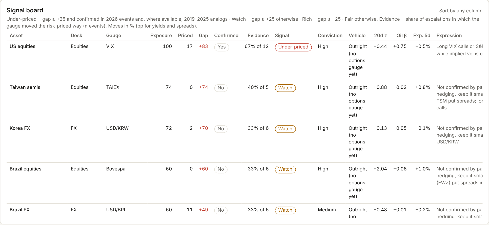
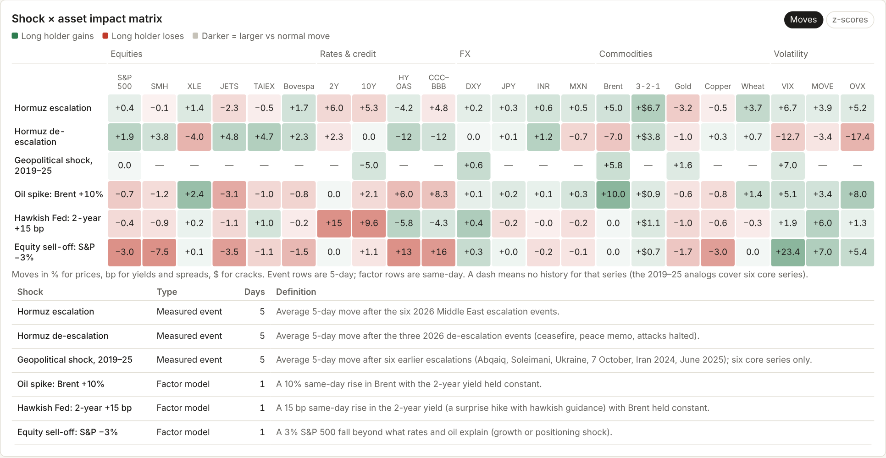
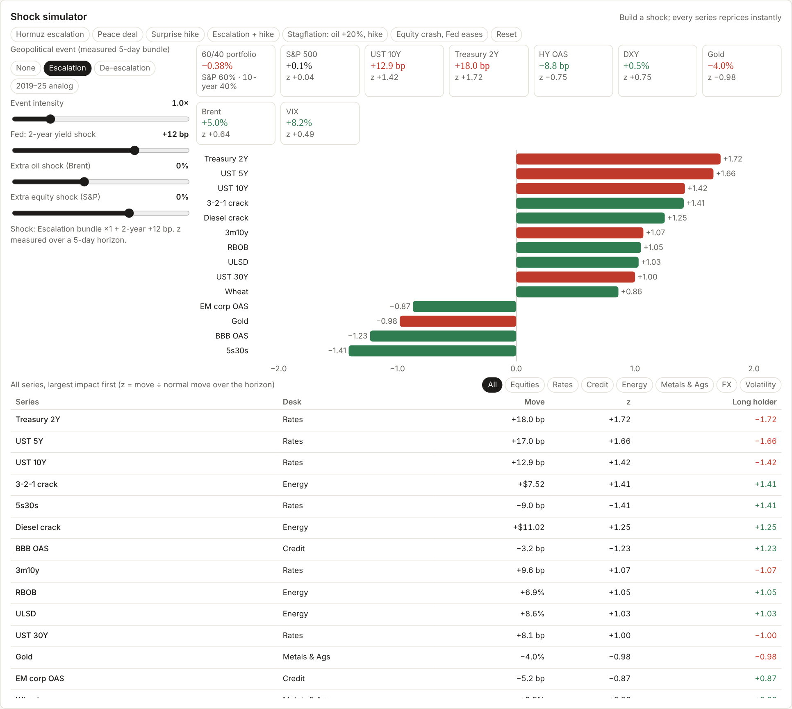
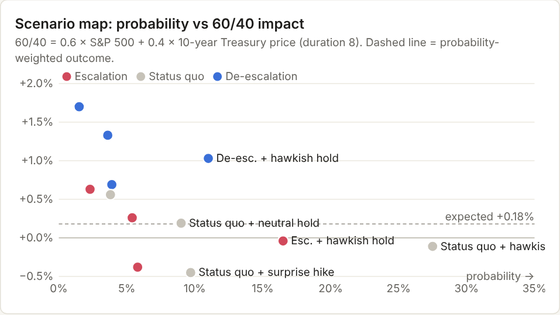
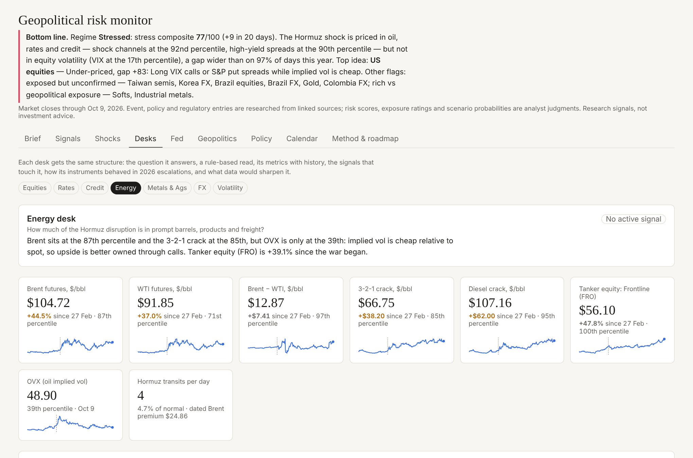
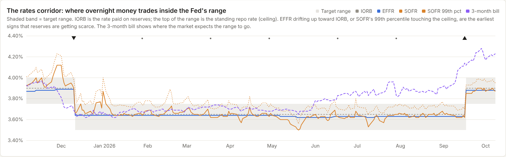
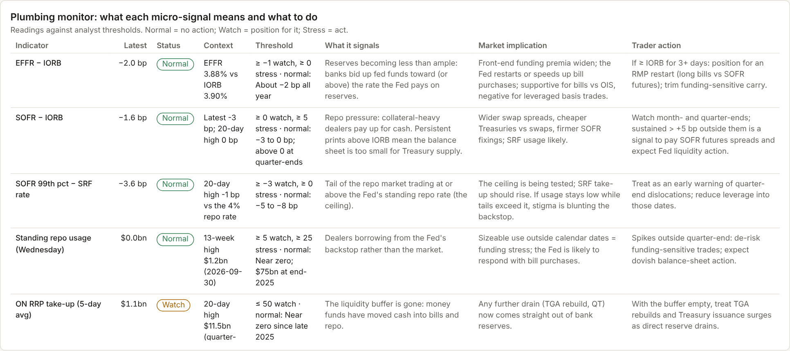

# 03 · Features and outputs

This guide covers each of the nine views on the page and every file the build exports. For each panel it gives what it shows, how to read it and who it is for. Example readings are from the 9 October 2026 snapshot.

- [Brief](#brief)
- [Signals](#signals)
- [Shocks](#shocks)
- [Desks](#desks)
- [Fed](#fed)
- [Geopolitics](#geopolitics)
- [Policy](#policy)
- [Calendar](#calendar)
- [Method & roadmap](#method--roadmap)
- [Exported outputs](#exported-outputs)
- [How the views fit a research workflow](#how-the-views-fit-a-research-workflow)

Every view is linkable (`#signals`, `#fed`, …). Every number on the page is computed from the data when it loads, so the prose updates when the data does.

---

## Brief

**For:** portfolio managers, the CIO, trading directors. **Question:** what matters this morning, and what do we do about it?

| Panel | What it shows | How to read it |
|---|---|---|
| **Headline** | Regime, stress composite and its 20-day change, pricing gap and its percentile | *Stressed, composite 77 (+9), gap 75, wider than 97% of the year*: shock channels are stretched but equity vol is not paying for it |
| **Fed watch** | Policy stance, Fedspeak tone, next FOMC date with hike odds, 2-year minus EFFR | *Tightening bias, +0.75 tone, 19% October and 70% December hike odds* |
| **Fed plumbing** | Reserves, ON RRP, standing repo, discount window, with Normal / Watch / Stress | Two indicators on Watch (ON RRP near zero, discount window $10bn) |
| **Trade ideas for the week** | Top six signals: asset, signal and conviction, gap, evidence (hit rate and sample), expression | Read the evidence column before the gap. A *Watch* has a gap but no confirmation from past escalations |
| **What moved this week** | The ten largest 5-day moves relative to each series' normal 5-day move | Surfaces moves that are big for that asset, not just big in percent |
| **Next 30 days** | Dated catalysts with days to go | CPI, the Brazil runoff and the 28 Oct FOMC in the current window |
| **Desk views** | One rule-based sentence per desk | The single most important read for each of the seven desks |
| **Does the pricing-gap signal work?** | Backtest buckets: share of 10-day windows in which VIX rose, by gap size | 73% when the gap is ≥ 50, vs 48% when < 25 (in-sample) |
| **Scenario stress test** | Most likely, worst plausible, probability-weighted and stress outcomes for a 60/40 | Most likely −0.11%; worst with ≥ 5% odds −0.45%; stress −0.31% with VIX +14.9% |
| **Headway on deliverables** | Roadmap by status | 26 deliverables, 73% live including proxies |
| **Global hotspots by region** | Live catalysts per region, escalating count, top risk score | Middle East carries the highest score (5) |

## Signals

**For:** PMs and strategists. **Question:** which assets are mispriced relative to their geopolitical exposure, and does history back it up?

| Panel | What it shows | How to read it |
|---|---|---|
| **From risk ranking to tradable signal** | The four-step logic: exposure → priced → gap → confirmation | The key that explains every column of the signal board |
| **Is the shock priced?** | The stress composite and pricing gap over a year | When the gap line is high, the shock channels are stressed but VIX is not |
| **Signal board** | 17 asset classes. Columns: exposure index, priced percentile, gap, confirmation, evidence hit rate, signal, 20-day momentum z, oil beta, scenario-weighted 5-day move. Sortable | *Under-priced* = hedge it; *Rich* = fade the premium; *Watch* = gap without confirmation; *Fair* = leave it |
| **Risk-premium gap by asset** | The gap as bars, sorted | Fastest way to see which assets carry too little or too much premium |
| **Which instruments actually hedged 2026 escalations?** | Vol-adjusted escalation z for every series | Cracks and products rose most. Gold fell and yields rose, so neither gold nor duration hedged this year |
| **Backtest: pricing gap vs forward volatility** | Forward VIX change and S&P return by gap bucket | Evidence the gap leads volatility, with the caveats stated |
| **History vs 2026** | 2019–25 analog response vs 2026 response, with an *Agree* flag | Gold and the 10-year *disagree*: in 2026 a hiking Fed and strong dollar overrode their haven role |
| **Historical analogs, event by event** | Each of the eight earlier shocks, 5-day moves | Shows the spread behind the averages |
| **2026 event study** | Mean 5-day move after escalations and de-escalations, share up, sensitivity, for all 52 series | The raw evidence behind confirmation and the shock lab |
| **Hormuz scenarios** | Escalation, status quo and de-escalation with descriptions and probabilities (analyst) | The assumptions behind the scenario-weighted moves |
| **Scenario-weighted expected move** | Probability-weighted 5-day move per series | Where the distribution leans, given the scenario odds |
| **Playbooks by audience** | What traders, PMs and strategists should do with today's readings | Written from the live numbers, so it updates with the data |

## Shocks

**For:** risk managers, PMs and directors. **Question:** what happens to every asset under a given shock, and what hedges it?

| Panel | What it shows | How to read it |
|---|---|---|
| **Shock × asset impact matrix** | Six shocks (rows) × 52 series (columns), coloured by position z | Green = a long holder gains, red = loses, scaled to each asset's normal move. Read down a column to see an asset's shock profile, or across a row to see a shock's footprint |
| **Shock simulator** | Sliders for the 2-year (bp), Brent (%) and an extra equity move (%), presets for each shock, and *Simulate* | Builds a custom shock from the three-factor betas, e.g. *2-year +15 bp and Brent +10% together*. Results are same-day and linear |
| **Transmission by desk** | For a chosen shock: average absolute z per desk and the series that moves most | Where the shock lands first. Escalation: Energy (3-2-1 crack), then Metals & Ags (wheat), then Rates |
| **Ranked impacts** | Every series' move under the chosen shock, sorted | The full distribution, largest winners to largest losers |
| **Best hedges and most exposed positions** | Up to five of each per shock, with a *History disagrees* flag | Escalation hedges: 3-2-1 and diesel cracks, gasoline, diesel, wheat. Most exposed: gold, Treasuries (5Y, 10Y, 2Y), defense ETF |
| **Combined scenarios: Hormuz × 28 Oct FOMC** | Twelve pairings with probability and moves for 11 assets and a 60/40, plus the probability-weighted row and a stress test | See below |
| **Scenario map** | Probability against 60/40 impact for each pairing | The upper-left (likely and painful) is what to hedge |
| **What the grid says** | Rule-based summary of the grid | Most likely, worst plausible, expected and stress outcomes in one paragraph |

**The six shocks**

| Shock | Type | Definition |
|---|---|---|
| Hormuz escalation | Event | Average 5-day move after the 2026 Middle East escalation events |
| Hormuz de-escalation | Event | Average 5-day move after the 2026 de-escalation events (ceasefire, memorandum, attacks halted) |
| Geopolitical shock, 2019–25 | Event | Average 5-day move after six earlier escalations; six core series only |
| Oil spike: Brent +10% | Factor | Same-day, 2-year held constant |
| Hawkish Fed: 2-year +15 bp | Factor | Same-day, Brent held constant |
| Equity sell-off: S&P −3% | Factor | Same-day, beyond what rates and oil explain |

## Desks

**For:** desk heads and traders. **Question:** what does my desk need to know today?

Seven desks: **Equities, Rates, Credit, Energy, Metals & Ags, FX, Volatility**. Each has the same four panels:

| Panel | What it shows |
|---|---|
| **Desk read** | The desk's question (Equities: "Which sectors and regions carry the war and election risk, and is it in the price?"), a rule-based read, what to watch, and the data gaps |
| **Chart** | The desk's instruments, rebased to 100 on 27 Feb 2026 or in native units (yields, spreads, vol points) |
| **Desk signals** | The metrics that drive the read: percentile, change since the war began, 1-month change, implied vs spot |
| **2026 escalation reactions** | How each of the desk's series moved after 2026 escalations and de-escalations |

Example reads:

- **Equities**: VIX is at the 17th percentile while the S&P 500 is up 12.7% since the war began. The war shows up in sectors (defense vs airlines −12.9%) rather than the index.
- **Rates**: bear steepening, with the 10-year +128 bp since 27 Feb and 3m10y +80 bp, an inflation and term-premium shock.
- **Credit**: CCC–BBB +185 bp in a month, so stress is concentrated in the weakest credits.
- **Energy**: Brent at the 87th percentile but OVX at the 39th. Implied vol is cheap relative to spot, so upside is better owned through calls.
- **FX**: the dollar is the haven (DXY at the 100th percentile, USD/CHF +7.1%), not the yen or franc.

## Fed

**For:** rates traders, PMs and strategists. **Question:** where is policy going, and is liquidity tightening underneath?

| Panel | What it shows | How to read it |
|---|---|---|
| **Policy read** | Stance from the last decision, Fedspeak tone and market pricing | *Tightening bias, patient on timing* |
| **Plumbing read** | Overall liquidity status: Ample, Watch or Stress | *Ample but on watch*: with ON RRP near zero, Treasury General Account swings move reserves one for one |
| **The rates corridor** | EFFR, SOFR and their 99th percentiles inside the target range, with IORB, the ON RRP rate and the standing repo rate | Overnight rates drifting up toward IORB or the top of the range is the first sign reserves are getting scarce |
| **Plumbing monitor** | Nine micro-indicators. For each: latest reading, Normal / Watch / Stress against thresholds, what it signals, the market implication and the action | The tracker for the Fed's small moves. Each row says what a move means and what to do about it |
| **Balance sheet and liquidity** | Reserves, TGA, Treasury holdings, ON RRP, standing repo, discount window | Weekly H.4.1 trends; discount window up $5.1bn in six weeks |
| **Policy path** | FOMC decisions since Oct 2025 with votes, dissents and the decision-day market reaction | *Dissent drift*: dissents moved from doves wanting easier policy to hawks wanting tighter, with the pressure flipping in April |
| **Market pricing of the next hikes** | Hike odds for 28 Oct and 9 Dec over time, by platform | October odds fell from a 77.5% peak to 19.4%; December about 70% |
| **Communications tracker** | Speeches and minutes with stance (−2 to +2), voter status, timing language and summary | Tone is the 30-day average stance |
| **28 Oct FOMC: outcomes and trader breakdown** | Four scenarios with probability, the assumed 2-year shock, what each would signal and the trade | The decision tree for the meeting |
| **Signal breakdown by asset** | Each asset's expected move under each FOMC outcome (rate-shock beta × 2-year shock) and the probability-weighted move | What each outcome does to the 2-year, 10-year, S&P, dollar, gold, credit and others |
| **Rate-shock betas and FOMC-day sensitivity** | Oil-controlled beta to the 2-year, an event-day cross-check and the average FOMC-day move | *Agree* = event days point the same way as the full-sample beta |

## Geopolitics

**For:** strategists and global affairs. **Question:** where are the hotspots, and what is the market saying about them?

| Panel | What it shows |
|---|---|
| **Catalysts against the market** | The stress composite over a year with dated geopolitical and policy events marked (escalations as red rings), so you can see which events moved markets |
| **Highest-risk live catalysts** | The live catalysts with the highest analyst risk scores, with status and channel |
| **Catalyst tracker** | All 47 catalysts, sortable by date, region, status and risk, each with a source link |
| **Regional market gauges** | TAIEX, Korean won and Indian rupee; copper, cocoa and rand; Bovespa, real, Mexican and Colombian peso, with changes and percentiles |
| **Physical vs paper oil** | Dated Brent premium to futures, Brent–WTI and Hormuz transits vs normal |
| **Daily geopolitical risk index** | 30 days of the Caldara–Iacoviello daily GPR |
| **Market-implied politics** | Kalshi and Polymarket odds for House, Senate and both chambers, March vs October |
| **Other market-implied probabilities** | October FOMC hike odds and the odds that the CLARITY Act becomes law in 2026 |
| **Regional indicators** | Hormuz shipping, sanctions, gas, policy rates and CPI, trade, fiscal, Taiwan Strait, Libya, Sudan, Brazil polls, Banxico |

## Policy

**For:** global affairs and strategists. **Question:** what are Washington and Brussels doing that moves markets?

| Panel | What it shows |
|---|---|
| **Policy and inflation backdrop** | Fed funds upper bound, ECB deposit rate, US headline and core CPI, the estimated US cost of the Iran war, and IEEPA tariff revenue exposed to refunds |
| **Washington monitor** | Congress (5 items), the Supreme Court (5) and agencies and regulators (9), each with status, last action, next date, why it matters and the assets affected |
| **US and EU regulation** | 16 measures by sector, US vs EU side by side |
| **Measure detail** | Stage, key date, summary and market impact for each measure |

## Calendar

**For:** everyone. **Question:** what is scheduled?

Twenty dated catalysts from 14 Oct 2026 to Dec 2027: data releases, central-bank meetings and minutes, elections (including Brazil's runoff), court dates, trade deadlines and EU regulatory dates. Each has a type, the assets affected and a source link. The Brief shows the next 30 days.

## Method & roadmap

**For:** reviewers and anyone inheriting the toolkit. **Question:** how is it built, and what is missing?

| Panel | What it shows |
|---|---|
| **Deliverables and headway** | 26 deliverables with audience, desk, status (Live, Live (proxy), In progress, Needs vendor data), detail and next step |
| **Exposure matrix** | Which catalyst channels move which asset classes (analyst ratings 0–3) |
| **Method and caveats** | Every rule in plain English, and the known weaknesses |
| **Data coverage** | Each dataset with rows, dates and source |

---

## Exported outputs

`run.sh` writes these files on every run (via `tests/check_calcs.mjs`). Open them in Excel or paste them into a note.

| File | Rows | Columns | Use it for |
|---|---:|---|---|
| `outputs/latest_brief.md` | — | Regime, trade ideas, Fed, scenario stress, desk reads, backtest | The morning note, ready to email |
| `signal_board.csv` | 17 | asset_class, desk, gauge, exposure_index, priced, gap, confirmed, risk_hit, evidence_n, signal, conviction, vehicle, mom_z20, oil_beta_60d, expected_5d, expression, pm_tilt | The full signal board |
| `trade_ideas.csv` | 6 | rank, asset_class, signal, conviction, gap, risk_hit, evidence_n, expected_5d, vehicle, expression, pm_tilt | The ranked ideas |
| `latest_readings.csv` | 52 | series, desk, kind, unit, ticker, source, date, value, chg_5d, chg_1m, chg_prewar, pct_rank, mom_z20, z_5d | A market snapshot across the universe |
| `event_study_2026.csv` | 52 | series, desk, kind, esc_mean, esc_up, esc_n, deesc_mean, deesc_up, deesc_n, sensitivity | 2026 escalation and de-escalation response |
| `history_vs_2026.csv` | 6 | hist/cur/pooled escalation means, hit rates and samples, agree | Whether 2026 behaves like past shocks |
| `gap_backtest.csv` | 4 | bucket, n, vix_fwd, vix_up, spx_fwd | Evidence for the pricing-gap signal |
| `desk_reads.csv` | 7 | desk, question, read, n_flags, top_flag | One line per desk |
| `shock_matrix.csv` | 266 | shock, series, desk, kind, unit, horizon, move, z, pos_z, basis | Every series under every shock |
| `shock_hedges.csv` | ≤ 60 | shock, side, rank, series, desk, move, pos_z, flag | Hedges and exposures per shock |
| `shock_betas.csv` | 52 | series, b_y2, b_oil, b_spx, r2, n, daily_sd | Factor betas for your own scenarios |
| `combined_scenarios.csv` | 14 | label, probability, 2-year shock, moves for 11 assets, p6040 | Hormuz × FOMC grid with expected and stress rows |
| `fed_monitor.csv` | 9 | indicator, value, unit, status, threshold, signals, implication, action | The plumbing monitor |
| `fomc_reactions.csv` | 8 | decision, vote, dissents, guidance, decision-day moves | Policy path and market reaction |
| `fed_scenario_breakdown.csv` | 12 | asset, beta_10bp, agree, move under each FOMC outcome, expected | The trader breakdown for 28 Oct |

The page reads the 24 datasets in `site/data/`, and `manifest.json` describes each one. They are plain JSON arrays and can be loaded into pandas with `pd.read_json`.

## How the views fit a research workflow

| Moment | View | Output |
|---|---|---|
| Morning meeting (5 minutes) | Brief | `latest_brief.md` pasted into the team note |
| Idea generation | Signals → Desks | `trade_ideas.csv`, `signal_board.csv` |
| Pre-trade check | Shocks (simulator, hedges) | `shock_matrix.csv`, `shock_hedges.csv` |
| Ahead of an FOMC or event | Fed, Calendar, combined scenarios | `fed_scenario_breakdown.csv`, `combined_scenarios.csv` |
| Weekly risk review | Shocks, Fed plumbing | `fed_monitor.csv`, `combined_scenarios.csv` |
| Policy briefing | Geopolitics, Policy | Catalyst tracker, Washington and regulation tables |
| Progress update to directors | Method & roadmap | Deliverables headway |
